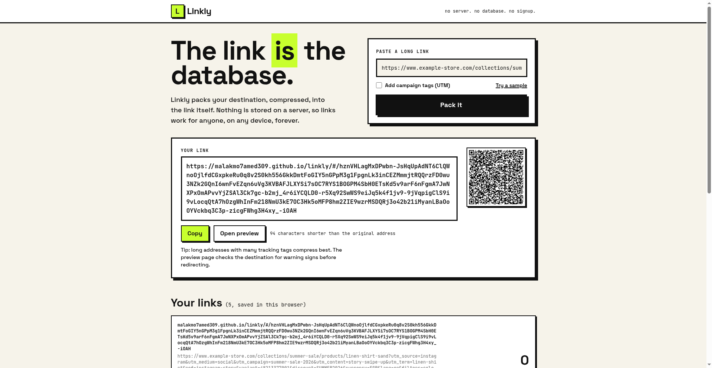

# Linkly

A link shortener with no backend. The destination is packed into the short link itself, so there is nothing to host, nothing to sign up for, and nothing that can go down.

**Live demo:** https://malakmo7amed309.github.io/linkly/



## Standout feature

Serverless links. `src/codec.js` compresses the URL with the browser's built-in `CompressionStream` (raw deflate), encodes it as base64url, and puts it after the `#/` in the page address. Opening that link unpacks it again in the browser. Long URLs with repeated query strings (UTM tags especially) come out noticeably shorter, and the app tells you honestly when a link would end up longer than the original.

## What's inside

- Safety preview before every redirect: shows the real host and flags raw IP addresses, look-alike (punycode) domains, stacked subdomains, credentials in the URL and plain http
- QR code for every link (generated in the browser)
- UTM tag builder
- Local click stats with a 14-day bar chart. Counts only cover visits from the same browser, since there is no server to collect them
- Your links are saved in localStorage

## Stack

Preact, Tailwind CSS 4, Vite (single-file build), `qrcode-generator`. Fonts: Space Grotesk and JetBrains Mono.

## Run locally

```
npm install
npm run dev
```

The build is one self-contained `dist/index.html`, which GitHub Pages serves from `docs/`.
